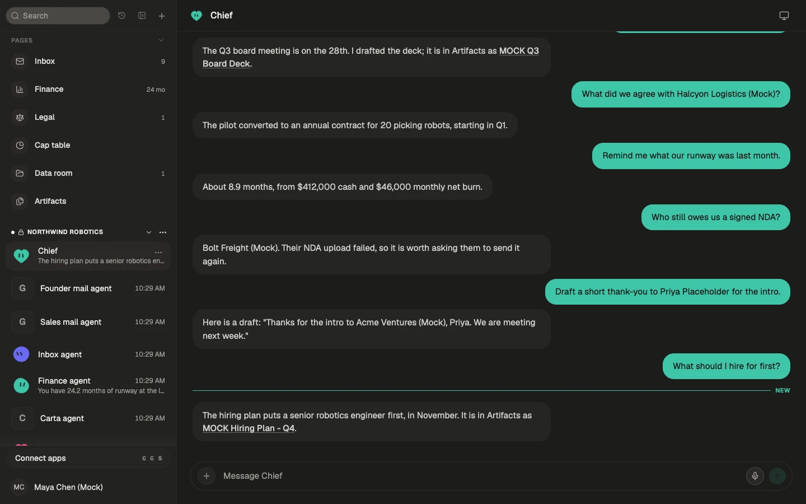
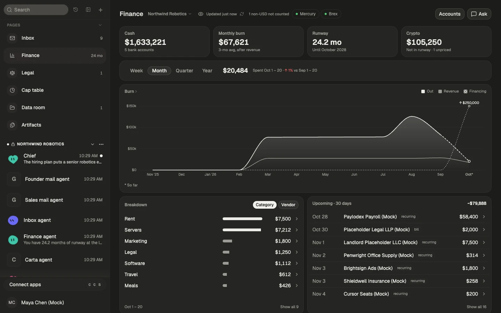

# Praci

Praci is an opinionated fork of [Rakazo](https://github.com/elie222/rakazo) by the Rakazo contributors, under Apache-2.0.

[](https://github.com/dennisonbertram/praci/stargazers)

Praci is an open source AI assistant built from persistent bots. Each bot has its own conversation,
memory, routines, and a computer it can use for the browser, terminal, and files. You can run it on
your own machine or server, bring your own model credentials, and connect your mail, finance, cap
table, and documents. It runs as a web app, an Electron desktop app, and an Expo mobile app. Praci is
in beta.





The screenshots show invented demo data from `pnpm demo:up`, not a real company.

## Ways to run Praci

- **Desktop app.** Choose **This computer** and the app starts the stack with Docker Compose, so
  Docker Desktop, OrbStack, or Docker Engine must be installed. To build a copy that runs entirely
  from this checkout, see
  [Self-contained local build](./docs/desktop-release.md#self-contained-local-build).
- **Self-hosting.** Run the published images or a source checkout on your own machine or a server.
  See the [self-hosting guide](./docs/self-host.md).
- **Hosted.** A hosted version is planned. Join the waitlist at
  [praci-waitlist.vercel.app](https://praci-waitlist.vercel.app).

## Features

- Persistent bots with their own conversations, memory, routines, and history
- Voice mode: speak replies, dictate, and call a bot, with your own ElevenLabs, OpenAI, Cartesia, or Fish Audio key
- Shared Team Computers and isolated Private computers with browser, terminal, file, and graphical desktop access
- Bots that can delegate to peer bots or short-lived subagents
- Bring-your-own model credentials through Pi
- App integrations through Composio or Pipedream Connect, plus user-installed Treg, remote MCP, and OpenAPI tool sources
- Docker, E2B, Daytona, CreateOS, Box, and trusted local-computer support

## Quick start for developers

You need Node.js 22.22.2 or newer in the 22.x line, Node.js 24.x, or Node.js 26+; pnpm 9; and Docker.
Node.js 23.x and 25.x are not supported.

```bash
git clone https://github.com/dennisonbertram/praci.git
cd praci
cp .env.example .env
```

Set `POSTGRES_PASSWORD` (for example `openssl rand -hex 16`), then put the same value in
`DATABASE_URL`. Set `BETTER_AUTH_SECRET`, `ENCRYPTION_KEY`, and `SCREEN_PROXY_SECRET` to independent
long random values, and `SANDBOX_SUPERVISOR_TOKEN` for Docker sandboxes. For host-side development
with Docker Desktop, set `SANDBOX_CONTROL_VIA_LOOPBACK=true`. You can set `OPENROUTER_API_KEY`, or
connect a model provider during onboarding.

```bash
docker compose --env-file .env \
  -f infra/compose/docker-compose.yml \
  -f infra/compose/docker-compose.postgres-host.yml \
  up postgres -d
pnpm install
pnpm db:generate
pnpm db:migrate
pnpm sandbox:build
pnpm dev
```

Open [http://127.0.0.1:5173](http://127.0.0.1:5173), create an account, connect a model, and create
your first bot. To run the Electron app against this stack, use
`pnpm --filter @rakazo/desktop dev` and choose **Existing instance**.

`pnpm demo:up` starts a separate stack with invented company data and prints its URL and login. Stop
it with `pnpm demo:down`.

Common checks are `pnpm lint`, `pnpm check`, and `pnpm test`. The repository layout is `apps/` (web,
api, worker, desktop, mobile, and the public website), `packages/` (domain, contracts, persistence,
adapters, UI), `infra/`, and `docs/`. See [CONTRIBUTING.md](./CONTRIBUTING.md) for the workflow.

## Documentation

- [Self-hosting](./docs/self-host.md) and [secrets](./docs/self-host-secrets.md)
- [Computer runtime and isolation](./docs/computer-runtime.md)
- [Desktop releases](./docs/desktop-release.md)
- [Mobile releases](./docs/mobile-release.md)
- [Data room setup, search and embeddings](./docs/data-room/README.md#setting-up-from-scratch)

## License and credit

Praci is licensed under the [Apache License 2.0](./LICENSE). It is a fork of
[Rakazo](https://github.com/elie222/rakazo); credit for the original work belongs to its contributors.
For security vulnerabilities, follow [SECURITY.md](./SECURITY.md) instead of filing a public issue.
